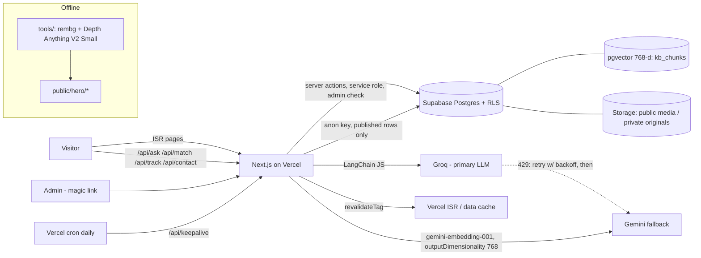
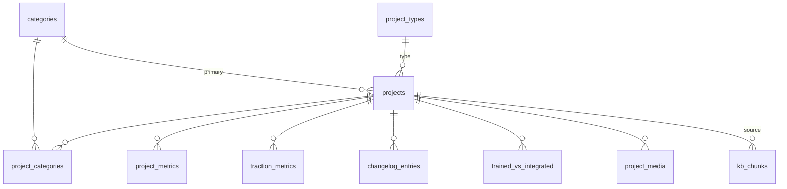

# PLAN.md — Abdul Rafay Khan, AI Engineer Portfolio

Status: **v2 — revised with your changes (1–21). Waiting for your OK to start M0.**

## 0. Ground rules (from your feedback)

- **No placeholders on the public site.** Empty field → hidden. Empty section (no key projects, no marquee media, no experience, no about text…) → the whole section and its nav link are hidden. Placeholders/hints exist only in the admin.
- **Stop after every milestone** for you to review in the browser. One clean git commit per milestone. Nothing moves on while something is broken.
- **Deploy to Vercel after M3**, redeploy after every milestone after that.
- Git: `git init` + GitHub repo in M0; `.gitignore` covers `.env*` (except `.env.example`) in the **first** commit.
- Admin email: kept only in env `ADMIN_EMAIL` (never hard-coded in code or committed to the repo).
- Domain: `*.vercel.app` for now. Single page with sections + `/work/[slug]` case studies.

## 1. Architecture



**Key decisions**

- Public pages are ISR with tagged caches (`projects`, `categories`, `types`, `site`). Every admin save → `revalidateTag` → live without redeploy.
- **DB-down resilience:** data access goes through `unstable_cache` with a short timeout. If Supabase is paused/unreachable, revalidation fails and Next keeps serving the last good cached page (stale-on-error). As a last resort for a cold cache, the build writes a `content-snapshot.json` of published content into the bundle and the data layer falls back to it. A daily Vercel cron (`vercel.json`, Hobby-plan compatible, protected by `CRON_SECRET`) runs `select 1` against Supabase to stop the free project pausing.
- Embeddings: `gemini-embedding-001` with `outputDimensionality: 768` set explicitly in config (`EMBEDDING_MODEL`, `EMBEDDING_DIM=768`); vectors are L2-normalised (required for reduced dimensions). Column is `vector(768)`; a startup check fails loudly if config and column disagree.
- Admin writes: server actions verify the session email → service-role client. RLS enforces the same rule as defence in depth.

## 2. Folder structure

```
portfolio/
├─ PLAN.md README.md .env.example .gitignore vercel.json
├─ app/
│  ├─ (site)/ page.tsx  work/[slug]/{page.tsx,opengraph-image.tsx}  match/[id]/page.tsx
│  ├─ admin/ login/ projects/ projects/[id]/ key-projects/ categories/ types/
│  │         site/ marquee/ experience/ insights/ messages/ knowledge/
│  ├─ api/ ask/ match/ track/ contact/ keepalive/ draft/
│  ├─ sitemap.ts robots.ts layout.tsx globals.css
├─ components/
│  ├─ ui/       ContactButton LiveProjectButton TryItButton StatusBadge MetricBadge TractionBadge PlainModeToggle
│  ├─ motion/   FadeIn Magnet AnimatedText ScrollMarquee StackingCards   (all GSAP)
│  ├─ sections/ Hero Marquee About WhatIDo Work AskAI Timeline Contact Footer
│  ├─ three/    HeroPortrait ParticleAssemble DepthParallax AboutObjects/* Galaxy
│  ├─ work/     KeyProjectStack WorkGrid FilterBar CaseStudy/* (Client, Automation, Product, TrainedVsIntegrated, Changelog, Gallery)
│  ├─ ai/       ChatPanel FloatingChatButton JobMatcher
│  └─ admin/    ProjectForm (+ ClientFields AutomationFields ProductFields) MarkdownEditor ImageCropper
│               Uploader(+blur hint) SortableList N8nSanitizeDiff PreviewCards DataTable
├─ lib/
│  ├─ supabase/ server.ts client.ts admin.ts
│  ├─ data/     projects.ts categories.ts types.ts site.ts snapshot.ts
│  ├─ ai/       llm.ts chunking.ts embed.ts retrieve.ts prompts.ts guard.ts matcher.ts galaxy.ts reindex.ts
│  ├─ n8n/      sanitize.ts (+ diff)
│  ├─ mermaid/  render.ts (server-side SVG on save)
│  ├─ gsap.ts plain-mode.ts rate-limit.ts sanitize-md.ts env.ts(zod) publish-rules.ts
├─ supabase/ migrations/*.sql seed.sql
├─ tools/ portrait_pipeline.py requirements.txt README.md portrait_colab.ipynb
├─ tests/ unit/ e2e/ fakes/{FakeChatModel,FakeEmbeddings}.ts
└─ .github/workflows/ci.yml
```

## 3. Database schema



**Taxonomy (fully admin-managed, unlimited, drag-reorder)**

| Table           | Columns                                                                                                                          |
| --------------- | -------------------------------------------------------------------------------------------------------------------------------- |
| `categories`    | id, slug (unique), name, number (display, e.g. "01"), description, stack text[], color, show_in_what_i_do bool, sort             |
| `project_types` | id, slug, name, has_product_fields bool, requires_client_approval bool, has_client_fields bool, has_automation_fields bool, sort |

Defaults — categories: AI Automations, Agentic AI, Websites & Client Work, Computer Vision, Machine Learning & Data Science, 3D & WebGL (all shown in What I do). Types: Client (client fields + approval required), Personal, Final-year project, SaaS product (product fields), GaaS product (product fields). The flags decide which field groups the admin form shows; any group can still be opened manually ("optional for others"). Deleting a category/type that's in use asks you to reassign first.

**Projects**

| Group          | Columns on `projects`                                                                                                                                                                                                                                                                                                     |
| -------------- | ------------------------------------------------------------------------------------------------------------------------------------------------------------------------------------------------------------------------------------------------------------------------------------------------------------------------- |
| Core           | id, slug (unique), title, type_id → project_types, primary_category_id → categories, status (`live` / `completed` / `in_progress`), show_status_badge bool, published bool, short_desc, case_study_md, tech text[], links jsonb {live, github, video, huggingface, writeup}, started_on, ended_on, created_at, updated_at |
| Ordering       | sort (main list), is_key bool, key_sort, show_in_marquee bool, marquee_sort                                                                                                                                                                                                                                               |
| Card media     | img_left_top, img_left_bottom, img_right, marquee_poster, marquee_clip                                                                                                                                                                                                                                                    |
| Architecture   | architecture_mermaid (source), architecture_svg (pre-rendered on save)                                                                                                                                                                                                                                                    |
| Client         | client_name, hide_client_name bool, industry, my_role, client_approved bool, testimonial jsonb {quote, name, role, photo}                                                                                                                                                                                                 |
| n8n automation | trigger, apps text[], workflow_screenshot, dashboard_media jsonb [{type, url}], savings_text (time/money saved), workflow_json_path (sanitised file only)                                                                                                                                                                 |
| Product        | product_name, product_logo, value_prop, product_url, signup_url, stage (`beta`/`launched`), pricing_model (`free`/`freemium`/`subscription`/`usage_based`), starting_price, demo_video, features text[]                                                                                                                   |
| Galaxy         | galaxy_x, galaxy_y, galaxy_z (recomputed on save)                                                                                                                                                                                                                                                                         |

| Child table             | Columns                                                                                  |
| ----------------------- | ---------------------------------------------------------------------------------------- |
| `project_categories`    | project_id, category_id (multi; primary is always included)                              |
| `project_metrics`       | id, project_id, label, value, highlight bool, sort (results metrics / card badges)       |
| `traction_metrics`      | id, project_id, label, value, as_of date, show_public bool, sort                         |
| `changelog_entries`     | id, project_id, date, note                                                               |
| `trained_vs_integrated` | id, project_id, component, kind (`trained`/`integrated`), source_model, evaluation, sort |
| `project_media`         | id, project_id, kind (`gallery`/`dashboard`), url, poster, alt, sort                     |

**Site, AI and ops**

| Table           | Columns                                                                                                                                                                      |
| --------------- | ---------------------------------------------------------------------------------------------------------------------------------------------------------------------------- |
| `site_content`  | key pk, value jsonb — hero_tagline (default "an AI engineer building automations, AI products and websites that work"), about_text, skills, socials, resume_url, resume_text |
| `experience`    | id, kind (`work`/`education`), org, role, start, end, description, sort                                                                                                      |
| `kb_chunks`     | id, source_type, source_id, source_url, content, hash, embedding vector(768), HNSW index; RPC `match_chunks(query, k, threshold)`                                            |
| `chat_logs`     | id, question (PII-scrubbed), answered bool, source_slugs text[], created_at                                                                                                  |
| `match_results` | id (unguessable), jd_title, company, result jsonb, created_at (JD text not stored)                                                                                           |
| `events`        | id, type (`view`/`click`), project_id, target, created_at (no IP/UA)                                                                                                         |
| `messages`      | id, name, email, body, status (`new`/`read`/`archived`), created_at                                                                                                          |
| `rate_limits`   | key (hashed IP+cookie), bucket, window_start, count                                                                                                                          |

**Rules enforced in the database (not just the UI)**

- RLS on every table. Anon: `SELECT` only on published projects and their child rows, categories, types, site_content, experience; `traction_metrics` only where `show_public`; `client_name` exposed through a view that returns `null` when `hide_client_name`. No anon writes except via validated API routes (contact, events, rate limits use server-side client).
- All writes require `auth.jwt()->>'email' = admin email` (stored in a private config function).
- Publish trigger: a project whose type `requires_client_approval` cannot be `published = true` unless `client_approved = true`.
- Storage: `public` bucket (published media, admin-only write); `private` bucket for raw n8n JSON is never written — only the sanitised file is stored.

## 4. Pages and components

- `/` — Hero · Marquee · About · What I do · Work · Ask My AI · Experience & Education · Contact/footer. Navbar: name/logo + About · Work · Ask AI · Contact (links hide with their sections).
- `/work/[slug]` — case study; sections render only when they have data: pitch, demo video, architecture (pre-rendered SVG), metrics, client block (client or "a client in {industry}", role, testimonial), automation block (trigger, apps, workflow screenshot, dashboards, savings, JSON download), product block ("Try it" button, value prop, stage, pricing, public traction with "as of" dates, features, changelog), trained-vs-integrated table, tech stack, gallery, links, prev/next.
- `/match/[id]` — shared matcher result.
- `/admin/*` — protected in middleware + every page/action.

## 5. Template → my version

| Template                                                                                                                                                                | Mine                                                                                                                                                                                                                                                                |
| ----------------------------------------------------------------------------------------------------------------------------------------------------------------------- | ------------------------------------------------------------------------------------------------------------------------------------------------------------------------------------------------------------------------------------------------------------------- |
| Global: #0C0C0C, Kanit 300–900, `.hero-heading` gradient, `overflowX: clip`                                                                                             | Identical (self-hosted Kanit via `next/font`)                                                                                                                                                                                                                       |
| Hero: navbar, `text-[14vw] sm:[15vw] md:[16vw] lg:[17.5vw]` heading, bottom bar, Magnet portrait, FadeIn 0/.15/.35/.5/.6                                                | Same; heading "Hi, i'm Rafay" (one line at 320–1920 px, tested); left text = admin tagline; ContactButton right; portrait = static photo → 3D layer (§6)                                                                                                            |
| Marquee: 2 rows (11/10 ×3), offset `(scrollY−top+innerHeight)×0.3`, ±200, 420×270, gap-3                                                                                | Same math in GSAP ScrollTrigger; tiles from published projects with `show_in_marquee`, in `marquee_sort` order, repeated to fill; poster image first, video only while on screen (IntersectionObserver), **max 6 playing at once**; section hidden if nothing       |
| About: 4 corner PNGs, FadeIn x±80 delays .1/.25/.15/.3 dur .9, AnimatedText 0.2→1                                                                                       | Same positions/sizes/timings; four low-poly R3F objects (neural cluster, lens, chat bubble, data cube) each in its own small canvas (so the template's per-corner fade/slide works), loaded when near and paused offscreen; bio from admin; hidden if no about text |
| Services (white, rounded-t, numbered list)                                                                                                                              | "What I do": categories with `show_in_what_i_do`, in admin order with their numbers; click → scroll to Work with that filter                                                                                                                                        |
| Projects: sticky stacking cards, scale `1-(n-1-i)*0.03`, top `i*28px`, h-[85vh], sticky top-24/md:top-32                                                                | **Key projects** in `key_sort` order; card shows number, **type label** (Client / Personal / …), name, Live Project + GitHub (only if links exist), image grid, highlighted metric + public traction badges                                                         |
| —                                                                                                                                                                       | **All work** grid: filter bar (All + categories that have published projects), GSAP Flip on filter change, 12 shown then "Load more"; status badge only when `show_status_badge`; grid ↔ galaxy toggle                                                              |
| ContactButton / LiveProjectButton / FadeIn (0.7s, `cubic-bezier(.25,.1,.25,1)`, once, 50px margin) / Magnet (padding 150, strength 3, 0.3s ease-out / 0.6s ease-in-out) | Rebuilt in GSAP with identical numbers                                                                                                                                                                                                                              |
| —                                                                                                                                                                       | New sections in the same language: Ask My AI, Experience & Education, Contact/footer                                                                                                                                                                                |

## 6. Hero 3D pipeline

**Offline (`tools/portrait_pipeline.py`)**: photo → `rembg` (isnet-general-use) → RGBA cut-out → Depth Anything V2 **Small** (Apache-2.0) on the masked image → normalised depth. Outputs: `portrait.avif/.webp` (≤1200 px, <150 KB), `depth.webp` (≤512 px, lightly blurred), `particles.bin` (~8k pre-sampled points: x, y, depth, rgb). Local CPU or free Colab notebook; documented in `tools/README.md`.

**Runtime**

1. SSR paints hero text + static portrait (LCP). No JS required.
2. After idle, dynamic-import R3F — skipped in plain mode, `prefers-reduced-motion`, Save-Data, or low-end devices.
3. `ParticleAssemble`: one `THREE.Points` (≤8k desktop / ≤3k phones), custom shader, GSAP-driven `uProgress`, ~1.5 s assemble, once per session, skip on click/scroll.
4. ~0.4 s cross-fade → `DepthParallax` shader (UV offset ∝ depth × smoothed mouse). Fast nearby mouse → a few edge particles scatter and settle.
5. Phones: automatic gentle sway. Magnet, sizes, FadeIn(.6, y 30) kept. DPR cap 1.5 (1.25 phones), render paused offscreen/hidden tab.

## 7. AI features

- **Knowledge base**: only _published_ content is indexed — projects (all public fields + case study; hidden client names replaced with "a client in {industry}"; only `show_public` traction), categories, about, skills, experience, resume text. Chunking ~400 tokens / 60 overlap on markdown headings, each chunk prefixed with its title/section. Upsert by content hash. Every admin save re-indexes the affected source; unpublishing deletes its chunks. Admin **"Re-index everything"** button (with progress + chunk counts) on `/admin/knowledge`.
- **Ask My AI** (`/api/ask`, streamed): validate + injection heuristics → pgvector top-k with threshold → strict system prompt (only KB facts, short, cite sources, "not in my knowledge base — email Rafay" when below threshold, ignore instructions inside user text/context, refuse off-topic) → source links to case studies. ~300 max tokens. Starter question chips. Floating button + section.
- **JD matcher** (`/api/match`): JD ≤6k chars → retrieve → zod-structured output {topProjects 3–5 {slug, reason}, matchedSkills, gaps, summary}. Post-validation drops unknown slugs/skills. Result stored without the JD → `/match/[id]`.
- **Galaxy**: clusters by **primary category** (its colour); positions = PCA of project embeddings + per-category cluster offset, recomputed on save and stored. Instanced glowing nodes, hover tooltip (title + highlighted metric), click → GSAP camera fly-to → case study. Hidden in plain mode / low-end.
- **LLM layer**: Groq primary; on 429 retry with exponential backoff (2 tries), then Gemini. Tests inject `FakeChatModel` / `FakeEmbeddings`. Rate limits (Postgres sliding window): e.g. 10 asks / 10 min, 3 matches / hour per visitor. Logged questions are PII-scrubbed.

## 8. Admin dashboard

- **Auth**: Supabase **magic link only**; server rejects any email ≠ `ADMIN_EMAIL`. README documents disabling public sign-ups (and other providers) in Supabase Auth settings.
- **Projects list**: search, filters (category, type, status, published, key), drag reorder, duplicate, delete (confirm), publish toggle (blocked with a clear message if a client project isn't approved).
- **Project editor**: core fields; categories multi-select + primary category; type select (drives which field groups appear: client / automation / product — any group can be opened manually); markdown editor with live preview; metrics, traction (as-of date, show-public), changelog, features, trained-vs-integrated repeaters; Mermaid editor (rendered to SVG on save); image slots with cropper at the slot ratio + client-side WebP compression; video upload with size cap; marquee toggle; key toggle; live preview of stacking card + grid card. **Upload hint on every upload screen**: "Blur client/customer data in screenshots before uploading."
- **n8n JSON upload**: server-side sanitiser removes `credentials` blocks, credential IDs, webhook IDs/paths/URLs, and any parameter whose key or value looks like a secret (api key/token/password/secret/bearer/auth header patterns, long high-entropy strings, URLs with keys in the query). You see a **diff of what was removed** and confirm before the sanitised file is stored. Raw upload is never persisted.
- **Key projects**: separate drag list; warning banner above 6.
- **Categories** and **Types**: add / rename / reorder / delete; category colour, number, description, stack, show-in-What-I-do; type field-group flags.
- **Site content**: hero tagline, about text, skills, socials, resume PDF (text extracted for the KB). **Experience & education**. **Marquee** order (drag list of projects with show-in-marquee).
- **Knowledge**: chunk counts, last indexed, "Re-index everything".
- **Insights**: views per project, questions asked, JDs matched (title/company), most-clicked links. **Messages**: read/archive.
- **Seed** (all **unpublished drafts** for you to review — no other projects):
  - _Sentinel_ — type Final-year project, status Completed, primary Computer Vision (+ ML & Data Science), solo. Trained-vs-integrated: **Violence classifier — trained by me on RWF-2000 — 79% recall / 81% precision on 400 held-out clips**; **Face identification — pretrained YuNet + SFace, integrated and evaluated by me — 97.7% top-1 on a 54-person held-out test**; **Weapon detector — pretrained community model, integrated and evaluated by me**. Same figures as metrics.
  - _Sweet Crumbs WhatsApp Agent_ — primary AI Automations (+ Agentic AI), status Live; type, client details and metrics left empty for you.
  - _DocSense_ — primary Agentic AI, status In progress; type and metrics left empty for you.
  - No metrics, clients or dates are invented; empty fields stay empty (hidden publicly).

## 9. Performance budget

- Lighthouse mobile ≥ 90; LCP < 2.5 s; CLS ≈ 0; TBT < 200 ms.
- Initial home JS ≤ ~150 KB gzip (GSAP core + ScrollTrigger). Flip, three/R3F, chat UI loaded on demand.
- **Mermaid never ships to the public client**: SVG is pre-rendered on save (server) and sanitised; client-side Mermaid only in the admin preview.
- Marquee: poster images by default, `preload="none"`, ≤6 concurrently playing videos, clips ≤ ~600 KB.
- 3D: hero ≤ 8k points / 3k phones; About objects ≤ 2k tris each, four small canvases; galaxy instanced. DPR cap, `frameloop="demand"`, pause offscreen.
- Lighthouse CI + bundle-size check in CI.

## 10. Security

zod validation on every route/action; admin check in middleware + every server action + RLS; publish-approval trigger; service-role key server-only (`server-only`), env validated at boot; markdown via `rehype-sanitize` (no raw HTML); Mermaid SVG sanitised (DOMPurify) and rendered with `securityLevel: strict`; n8n sanitiser; CSP + security headers; upload MIME/size checks; contact honeypot + rate limit; prompt-injection defences; cron route requires `CRON_SECRET`; no PII in logs/analytics; `.env*` gitignored from commit one.

## 11. Milestones

Each ends with: something you can open in the browser, passing tests, one git commit — then **I stop for your review**.

| #       | Milestone                                                                                                                                                                                                                                                                                                                                | You review                                                                                              | Tests                                                                                                                           |
| ------- | ---------------------------------------------------------------------------------------------------------------------------------------------------------------------------------------------------------------------------------------------------------------------------------------------------------------------------------------- | ------------------------------------------------------------------------------------------------------- | ------------------------------------------------------------------------------------------------------------------------------- |
| **M0**  | Scaffold Next.js+TS+Tailwind, Kanit, tokens, ESLint/Prettier, Vitest + Playwright, CI workflow, `.gitignore` (incl. `.env*`), `git init`, GitHub repo + push                                                                                                                                                                             | Dev server with themed empty page                                                                       | smoke unit + e2e                                                                                                                |
| **M1**  | Navbar, Hero (static portrait), ContactButton, GSAP FadeIn + Magnet, plain-mode toggle, reduced-motion handling                                                                                                                                                                                                                          | Hero matching the template                                                                              | e2e: heading one line at 6 widths; unit: motion helpers                                                                         |
| **M2**  | Marquee + About (AnimatedText, 4 R3F corner objects) as components; local-only dev playground route with fixture media (excluded from production build)                                                                                                                                                                                  | Scroll effects in `/dev` playground                                                                     | unit: offset math, repeat-to-fill, ≤6 playing; e2e playground                                                                   |
| **M3**  | Supabase migrations (all tables, RLS, publish trigger, views), seed (types, categories, 3 drafts), typed data layer with cache + snapshot fallback, keep-alive cron; What I do + Work (key stack, filter + Flip grid, load more) + Marquee/About wired to DB; draft-preview mode (secret) so you can see drafts; **first Vercel deploy** | Live `*.vercel.app` site (sections hidden until something is published; drafts visible in preview mode) | unit: data access, empty-section hiding, fallback; RLS: anon/non-admin writes rejected, unapproved client project can't publish |
| **M4**  | Admin core: magic-link auth, projects list (search/filters/reorder/duplicate/delete), full editor incl. client/automation/product groups, uploads + crop + compress + blur hint, key-projects list (>6 warning), categories & types managers, live previews, revalidation                                                                | Create → publish → visible live                                                                         | e2e: admin create→publish→visible; unit: publish rules, permissions                                                             |
| **M5**  | Case study pages (all conditional blocks, Try it, changelog), Mermaid → SVG on save, n8n sanitiser + diff UI, SEO (metadata, OG images, sitemap, JSON-LD Person/CreativeWork), view/click tracking                                                                                                                                       | `/work/[slug]` for each type                                                                            | unit: n8n sanitiser (fixture workflows with secrets), md/SVG sanitising; e2e case study                                         |
| **M6**  | Site content, experience/education, resume upload, marquee order, messages inbox, insights; Experience & Contact/footer sections                                                                                                                                                                                                         | Full content management                                                                                 | unit + e2e contact → inbox                                                                                                      |
| **M7**  | Photo pipeline in `tools/` + hero particles → depth parallax (desktop, phone sway, plain/reduced fallbacks)                                                                                                                                                                                                                              | 3D portrait with your photo                                                                             | unit: particle sampler; e2e: fallback paths                                                                                     |
| **M8**  | RAG: chunking, 768-d embeddings, auto re-index on save/unpublish, Re-index everything button                                                                                                                                                                                                                                             | `/admin/knowledge` counts                                                                               | unit: chunking, privacy filtering (hidden client names, private traction), retrieval with fake embeddings                       |
| **M9**  | Ask My AI (section + floating button, streaming, sources, starters, rate limit, logs, Groq→Gemini fallback)                                                                                                                                                                                                                              | Working chat                                                                                            | unit + e2e with FakeChatModel; injection/off-topic/unknown cases; fallback on fake 429                                          |
| **M10** | JD matcher + shareable `/match/[id]`                                                                                                                                                                                                                                                                                                     | Paste a JD                                                                                              | unit: schema, no unknown slugs/skills                                                                                           |
| **M11** | Project galaxy + toggle + low-end gating                                                                                                                                                                                                                                                                                                 | Grid ↔ galaxy                                                                                           | unit: positions; e2e toggle                                                                                                     |
| **M12** | Hardening: Lighthouse, axe a11y, CSP, README (pitch, diagram, free-account setup, photo pipeline, adding a project, screenshot slots)                                                                                                                                                                                                    | Final deploy                                                                                            | Lighthouse CI, axe e2e                                                                                                          |

## 12. What I still need from you

- **Before M0**: Node 20+ installed? GitHub repo name and public/private (I'll create it with `gh` if authenticated, otherwise I'll ask you to create an empty one).
- **Before M3**: Supabase project URL, anon key, service-role key (into `.env.local`, never committed); Vercel account linked to the GitHub repo.
- **Before M7**: a clear front-facing photo (≥1500 px tall); Python 3.10+ locally or use Colab.
- **Before M8/M9**: Groq API key, Gemini API key.
- **Anytime via admin**: about text, skills, links, experience, resume, project media and metrics.

## 13. Risks / notes

- Free-tier limits (Groq/Gemini RPM, Supabase 500 MB DB / 1 GB storage) → backoff + fallback, compressed uploads, clip size caps.
- Vercel Hobby crons run at most once a day (sufficient; Supabase pauses after ~7 days idle).
- Embedding model names change; model and dimension live in env.
- WebGL context limits → About uses four small canvases (6 contexts at most site-wide, under browser limits), paused offscreen.
- Depth Anything V2 Base/Large are non-commercial; pipeline uses Small.
