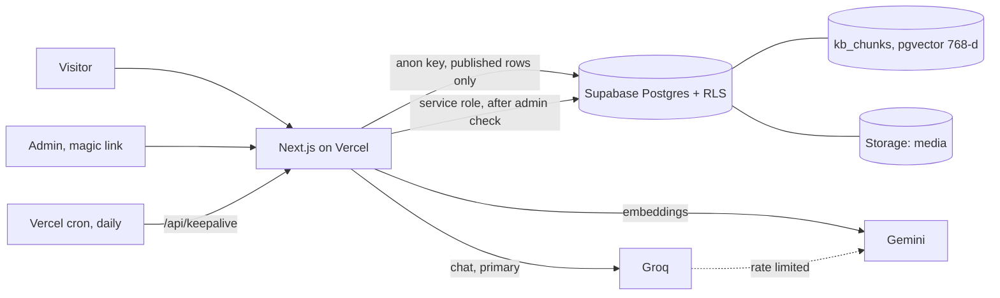

# Abdul Rafay Khan — AI Engineer portfolio

A cinematic, scroll-driven portfolio with a built-in admin dashboard and three AI features. Everything on the site is managed from `/admin`: add a project, publish it, and it is live (with its own case-study page, search-engine metadata and AI knowledge) without redeploying.

**Stack:** Next.js 16 (App Router, Cache Components) · TypeScript · Tailwind CSS 4 · GSAP · React Three Fiber / three.js · Supabase (Postgres, pgvector, Auth, Storage) · Groq + Gemini · Vercel.
Free tiers throughout: Vercel Hobby, Supabase Free, Groq free, Gemini free.

[PLAN.md](PLAN.md) holds the original architecture and schema notes.

## What it does

| Area                                              | What you get                                                                                                                                                                                                                                   |
| ------------------------------------------------- | ---------------------------------------------------------------------------------------------------------------------------------------------------------------------------------------------------------------------------------------------- |
| **Hero**                                          | A cinematic, scroll-pinned 3D hero built from your photo (depth-parallax plane, neural-net and architecture scenes), with a one-time particle intro. Falls back to the plain photo in plain mode, with reduced motion, or on weak devices.     |
| **Work**                                          | Key projects as sticky stacking cards, then a filterable grid with a **Grid / Galaxy** toggle. The galaxy is a 3D map: each category is a cluster, projects sit by similarity, hover shows the headline metric, click flies to the case study. |
| **Case studies**                                  | `/work/[slug]`: pitch, demo, product / client / automation blocks, trained-vs-integrated table, architecture diagram (Mermaid pre-rendered to SVG), changelog, downloadable cleaned n8n workflow. Every block shows only when it has data.     |
| **About, What I do, Education & skills, Contact** | All editable in the admin. Empty sections and their nav links disappear.                                                                                                                                                                       |
| **Ask my AI**                                     | A chat (section + floating button) that answers only from the site's own content, with links to the case studies. Says so when it does not know.                                                                                               |
| **Hiring?**                                       | Paste a job description; get a shareable `/match/[id]` page showing which projects and skills fit, and the gaps. The description is never stored.                                                                                              |
| **Admin**                                         | Magic-link sign-in for one email. Projects, key projects, categories, types, site content, education, marquee order, messages inbox, knowledge base, insights.                                                                                 |

## Architecture



- **Public pages** are statically rendered and cached under one tag. Every admin save invalidates it, so changes are live immediately.
- **If the database is down**, the last good copy (then a snapshot made at build time) keeps the site up. A daily cron stops the free Supabase project from pausing.
- **Admin writes are checked three times:** `proxy.ts` (route guard), every Server Action (`assertAdmin`), and Row Level Security in Postgres.
- **The knowledge base** is rebuilt incrementally on every save (only changed text is re-embedded). Hidden client names are replaced, private traction is left out, unpublished projects are removed.

## Setup with free accounts

Needs Node 20+ and a GitHub account.

### 1. Run it locally

```bash
npm install
cp .env.example .env.local     # then fill it in (steps below)
npm run dev                    # http://localhost:3000
```

The site runs with nothing configured: sections without content stay hidden.

### 2. Supabase (database, auth, storage)

1. Create a project at [supabase.com](https://supabase.com) (Free plan).
2. **Project Settings → API:** copy the project URL, the publishable (anon) key, and the secret (`service_role`) key into `.env.local` as `NEXT_PUBLIC_SUPABASE_URL`, `NEXT_PUBLIC_SUPABASE_ANON_KEY`, `SUPABASE_SERVICE_ROLE_KEY`.
3. **Project Settings → Database → Connection string (URI):** put it in `.env.local` as `SUPABASE_DB_URL` (local use only).
4. Set `ADMIN_EMAIL` to the one address allowed to sign in.
5. Create the schema and starter data:
   ```bash
   npm run db:apply            # migrations + admin email
   npm run db:apply -- --seed  # optional: types, categories and three draft projects
   ```
6. **Authentication → Users → Add user** with your admin email (tick _Auto Confirm User_).
7. **Authentication → Sign In / Providers:** turn off _Allow new users to sign up_.
8. **Authentication → URL Configuration:** set the Site URL to your live site and add `https://<your-site>/admin/auth/callback` and `http://localhost:3000/admin/auth/callback` to the Redirect URLs.

### 3. AI keys (optional, but needed for Ask my AI, the matcher and the galaxy)

- **Gemini:** [aistudio.google.com](https://aistudio.google.com) → API key → `GEMINI_API_KEY` (embeddings and the chat fallback).
- **Groq:** [console.groq.com](https://console.groq.com) → API key → `GROQ_API_KEY` (primary chat model).

Without these the chat, the matcher and the galaxy are simply not shown. Models can be changed with `GROQ_MODEL` and `GEMINI_CHAT_MODEL`; the answer cut-off with `ASK_MIN_SIMILARITY` (default 0.55).

### 4. Deploy to Vercel

1. Import the GitHub repo at [vercel.com](https://vercel.com) (Hobby plan).
2. Add every variable from `.env.local` under **Settings → Environment Variables** (Production and Preview). Mark secrets _Sensitive_.
   Required for the full site: the three Supabase variables, `ADMIN_EMAIL`, `CRON_SECRET`, `DRAFT_PREVIEW_SECRET`, `GEMINI_API_KEY`, `GROQ_API_KEY`. Optional: `VISITOR_SALT`.
3. Deploy. Open `/admin`, sign in with the magic link, and press **Re-index everything** on the Knowledge page.

`vercel.json` runs the functions in `bom1` (next to the default Supabase region; change it to match yours) and schedules the daily keep-alive.

### Environment variables

| Variable                                                                | Purpose                                                                      |
| ----------------------------------------------------------------------- | ---------------------------------------------------------------------------- |
| `NEXT_PUBLIC_SUPABASE_URL`, `NEXT_PUBLIC_SUPABASE_ANON_KEY`             | Public Supabase access (published content only, enforced by RLS).            |
| `SUPABASE_SERVICE_ROLE_KEY`                                             | Server only. Admin writes, the AI endpoints, draft preview. Never expose it. |
| `SUPABASE_DB_URL`                                                       | Local only, used by `npm run db:apply`.                                      |
| `ADMIN_EMAIL`                                                           | The only address that can sign in to `/admin`.                               |
| `CRON_SECRET`                                                           | Authorises the daily `/api/keepalive`.                                       |
| `DRAFT_PREVIEW_SECRET`                                                  | Signs the admin's draft-preview links.                                       |
| `GEMINI_API_KEY`, `GROQ_API_KEY`                                        | AI features.                                                                 |
| `GROQ_MODEL`, `GEMINI_CHAT_MODEL`, `ASK_MIN_SIMILARITY`, `VISITOR_SALT` | Optional tuning.                                                             |

Never commit `.env*` files (only `.env.example` is tracked).

## Using the admin

1. **Add a project:** _Projects → New_. Fill in the basics, pick a primary category and a type (the type decides which groups of fields appear: client, automation, product), write the case study in Markdown, add metrics, images and a diagram.
2. **Upload screenshots** (WebP is made in the browser). Blur client or customer data first: the reminder is on every upload screen.
3. **Publish.** A client project can only be published once you tick the client-approval box.
4. **Check it:** the site updates immediately; _Preview drafts_ shows unpublished work with a banner.
5. **Knowledge** shows what the AI can answer from. It updates by itself on every save; _Re-index everything_ rebuilds it.
6. **Messages** is the inbox for the contact form; **Insights** shows views, link clicks, questions asked and matched roles.

An uploaded n8n workflow is cleaned on the server (credentials, webhook ids and secret-looking values removed). You see exactly what was removed before anything is stored, and the raw file is never saved.

## The hero photo pipeline

The 3D hero is made from one photo with scripts in `tools/` (Python 3.10+; run offline, outputs are committed):

```bash
python -m venv tools/.venv && tools/.venv/Scripts/pip install rembg onnxruntime pillow numpy
tools/.venv/Scripts/python tools/cutout.py <your-photo>        # background removed → public/hero/portrait.webp
tools/.venv/Scripts/python tools/portrait_pipeline.py          # depth map + 8,000 particles → public/hero/
```

Depth comes from Depth Anything V2 Small (Apache-2.0, downloaded once into the gitignored `tools/models/`). The photo's pixels are never edited by the 3D scene. `tools/education_photos.py` prepares the graduation photo and degree.

## Checks

```bash
npm run lint
npm run typecheck
npm run test          # unit + database tests (Vitest; the DB tests run an in-process Postgres with the real migrations)
npm run test:e2e      # Playwright (first run: npx playwright install chromium)
npm run format:check
```

- **No real LLM is ever called in tests:** the model and embedder are injected, with fakes for both. Rate limits, row-level security, privacy filtering, prompt-injection handling, the Groq-to-Gemini fallback and the matcher's output validation are all covered.
- **End-to-end tests** cover the main pages, the hero's fallback paths, SEO, the admin flow (set `E2E_ADMIN=1`), accessibility (axe) and security headers. Point them at a deployed site with `E2E_BASE_URL=https://…`.
- **CI** (GitHub Actions) runs format, lint, types, tests, the production build, Playwright, and a Lighthouse budget (`lighthouserc.json`).

## Performance, accessibility and security

- **Budget and what is measured:** the target is Lighthouse mobile ≥ 90 with LCP < 2.5 s and TBT < 200 ms. With motion off (plain mode, reduced motion) the home page scores **99** (LCP 1.9 s, TBT 90 ms, 216 KB of script). With the cinematic 3D hero on, a lab run with no scrolling or tapping scores about **55–60** (LCP 3–5 s, TBT 0.8–1.2 s): three.js is roughly 190 KB of script and about a second of main-thread work, and the lab never scrolls, so the 3D canvas is the last thing painted. Real visitors usually scroll or tap within a second or two, which ends the lab-style LCP measurement. The 3D code, the chat and the galaxy are separate chunks loaded on demand, and Mermaid never ships to visitors (diagrams are SVG made on save). The accessibility, SEO and best-practices budgets are enforced in CI; the speed numbers are warnings (`lighthouserc.json`).
- **Motion:** plain mode (a visible toggle) and the OS reduced-motion setting turn off animation and all 3D. Weak, data-saver and low-memory devices get the static photo.
- **Accessibility:** one `h1`, landmarks, labelled controls, keyboard-reachable galaxy projects (a hidden link list), visible focus, axe checks in CI. Manual pass worth repeating after design changes: keyboard-only tour, a screen-reader pass of the chat and matcher, 200% zoom, and contrast over the animated hero.
- **Security:** a strict Content-Security-Policy and other headers (see `next.config.ts`), zod validation on every route and action, admin checked in three places, markdown and SVG sanitised, upload type and size checks, origin checks and Postgres rate limits on the contact form and both AI endpoints, prompt-injection guards, no personal data in analytics, secrets only in environment variables.

## Screenshots

Add images to `docs/screenshots/` and link them here.

| Slot       | File                              | Shows                          |
| ---------- | --------------------------------- | ------------------------------ |
| Hero       | `docs/screenshots/hero.png`       | The pinned 3D hero             |
| Work       | `docs/screenshots/work.png`       | Stacking cards and the grid    |
| Galaxy     | `docs/screenshots/galaxy.png`     | The galaxy view                |
| Case study | `docs/screenshots/case-study.png` | A full case study              |
| Ask my AI  | `docs/screenshots/ask.png`        | A streamed answer with sources |
| Matcher    | `docs/screenshots/match.png`      | A `/match/[id]` result         |
| Admin      | `docs/screenshots/admin.png`      | The projects list              |

## Project layout

```
app/            routes: home, /work/[slug], /match/[id], /admin, /api/*
components/     sections, hero + three.js scenes, admin screens, chat, galaxy
lib/            data layer, admin actions, rag (chunking, embeddings, sync),
                ask, match, llm (Groq/Gemini clients), galaxy, n8n sanitiser
supabase/       migrations/*.sql and seed.sql
tools/          offline photo pipeline (Python)
tests/          unit, db (PGlite + real migrations) and e2e
```
